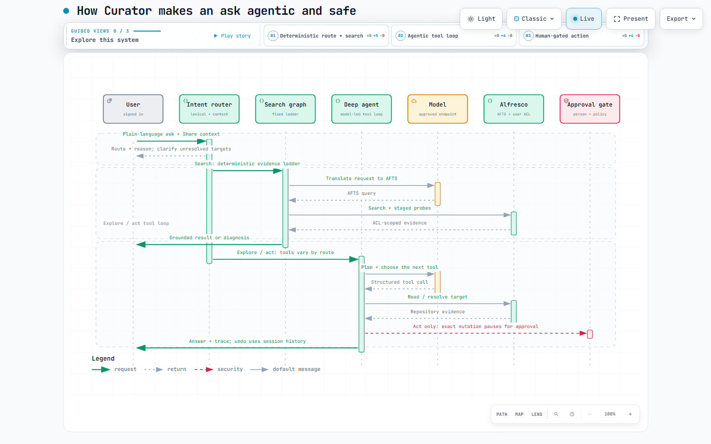

# Alfresco Curator

**Alfresco Curator** adds evidence-based search, diagnosis, and approval-gated
actions to Alfresco Content Services (ACS). Users ask in plain language; the
server selects a route and shows why.

[](LICENSE)
[](pyproject.toml)
[](#measured-not-claimed)

| Find | Plain language becomes AFTS; results use the signed-in user's permissions. |
| Explain | Staged repository probes identify why a query missed. |
| Act | A specific mutation waits for human approval and is audited. |

---

## Contents

[Quick start](#quick-start) · [Agentic approach](#agentic-approach) ·
[Evidence ladder](#evidence-ladder) · [Governance](#governance) ·
[Evaluation](#evaluation) · [Integrations](#share-and-digital-workspace) ·
[API](#api) · [Development](#development)

**First tour:** start with Community, try the example request, then open the
interactive agentic-flow diagram linked below.

## Quick start

Use the public Alfresco Community image for a demo. Prerequisites: Docker with
about 8 GB of memory and a working LLM key or endpoint. Curator downloads its
local embedding model when contextual suggestions are first requested.

1. Copy the template:

    ```powershell
    Copy-Item .env.example .env
    ```

2. In `.env`, select Community and configure the model provider:

    ```ini
    ALFRESCO_REPO_IMAGE=alfresco/alfresco-content-repository-community:26.2.0
    OPENAI_API_KEY=your-key
    ```

  Keep `LLM_PROVIDER=openai` for this example, or configure another supported
  provider/OpenAI-compatible endpoint.

3. Build and start the stack:

    ```powershell
    docker compose -f docker/docker-compose.yml up -d --build
    ```

  Compose builds Curator and Share, starts ACS/search, and seeds
  `demo.analyst` plus sample content. Wait for healthy services:

    ```powershell
    docker compose -f docker/docker-compose.yml ps
    ```

For the Enterprise repository image, leave `ALFRESCO_REPO_IMAGE` at its
default and run `docker login quay.io` first. Without a mounted licence, that
image runs on a two-day trial. Containers may start without an LLM key, but
Curator cannot complete model-backed requests until a provider is configured.

Try a read-only request first:

> Find approved S3 connector specifications in Engineering. Show names and paths only.

| Surface | URL | Credentials |
| --- | --- | --- |
| **Curator in Share** | <http://localhost:8180/share/page/curator> | `admin` / `admin` |
| **Curator in Digital Workspace** | <http://localhost:8280> | `admin` / `admin` |
| Curator standalone | <http://localhost:8600> | `admin` / `admin` |
| Alfresco REST API | <http://localhost:8080/alfresco> | `admin` / `admin` |

> **Demo data is local.** Compose seeds `demo.analyst` and sample documents in
> its Alfresco volumes. `docker compose down -v` deletes those volumes and the
> seeded repository data; avoid it if you want to keep your demo state.

## Agentic approach

`POST /api/agent/ask` classifies each request before an engine runs. The
classifier in [intent.py](src/alfresco_curator/agent/intent.py) is deterministic;
the model never decides whether a request may write.

| Route | What runs | Write access |
| --- | --- | --- |
| `search` | Fixed AFTS search and evidence graph | None |
| `explore` | Model-led deep-agent tool loop | Read tools only |
| `act` | Deep-agent tool loop with a proposed mutation | Per-operation approval |
| `undo` | Session audit inverse | No model call |
| `clarify` | Stops on unresolved references or missing context | No engine runs |

The route is shown in the UI with its reason. Share context resolves words such
as “these” and “here”; an instruction with nothing to point at stops before
search or write tools are built. A short “yes” or supplied value can continue a
pending action; a clear new search starts a new route.

### Search and diagnosis

`search` uses a fixed graph: translate to AFTS → search as the signed-in user →
report hits, or inspect empty-result clauses → retry a relaxed query → inspect
indexing only if query evidence does not explain the miss. Every probe uses the
same Alfresco ticket. The model writes the explanation from collected evidence;
it does not invent the clause matrix or an indexing cause.

### Model-led tool loop

`explore` and `act` use the deep agent: the model plans one step, selects from
the tools enabled for that route, reads the tool result, then decides what to
do next. `explore` receives read tools only. `act` additionally receives write
tools, but each mutation pauses for approval and is checked against governance
policy and the conversation budget again at execution. `undo` uses recorded
inverses rather than asking a model to reconstruct a change.

### Native Alfresco operations

Folder names and selected items are resolved to ACL-visible nodes before a
proposal is made. Curator can create native folder rules through the ACS API;
it checks the repository's action definition and presents the complete rule
for approval. Rules affect future content, not existing items. See the
[agentic routing diagram](https://tathagta15.github.io/alfresco-curator/agentic.html)
and the [approval sequence](https://tathagta15.github.io/alfresco-curator/).

[](https://tathagta15.github.io/alfresco-curator/agentic.html)

### Evidence ladder

Every probe runs against ACS as the signed-in user. The fixed ladder checks the
AFTS query, probes clauses and paths, retries without dead clauses, and traces
indexing only when query evidence does not explain the miss.


| Evidence | Next step |
| --- | --- |
| Invalid AFTS or a failing metadata clause | Report the query fault; do not blame indexing |
| A failing `TEXT:` / `cm:content` clause | Investigate transformation/content indexing |
| No dead clause or path explains the miss | Check the indexer pipeline |
| Node is in the trashcan | Report the repository state; do not trace indexing |

ACS 26.2 indexing polls the database through the batch indexer; it is not an
ActiveMQ queue. The [state machine](docs/diagrams/02-agent-state-machine.svg)
shows the fixed escalation path. The model receives gathered evidence to write
the explanation, not to choose which probes ran.

## Guardrails

([guardrails.py](src/alfresco_curator/agent/guardrails.py)) treats repository
content as untrusted input and fences tool output as data. Reports are checked
against supplied evidence: unsupported numbers and claims that a document or
folder does not exist are rejected. Guardrail and false-alarm suites run without
a model. Human approval remains separate from these checks.

## Governance

The client does not fetch document bodies for model prompts. Model calls may
receive metadata such as name, path, title, description, and MIME type; the
governance minimisation setting withholds titles and descriptions. Filenames
and paths can still be personal data.

| Control | What it does |
| --- | --- |
| **Decision ledger** | Durable, hash-chained record of every instruction, egress and change |
| **Endpoint allowlist** | A model host outside `GOVERNANCE_ALLOWED_MODEL_HOSTS` refuses to build |
| **Minimisation** | Withholds `cm:title` and `cm:description` from the model |
| **Tracing** | LangSmith prompt/tool tracing is controlled per model run |
| **Global change pause** | Blocks all repository changes, including already-pending approvals |
| **Document and folder operations** | Separately blocks create, rename, move, copy, delete, restore, version, lock, tag, comment, favorite, aspect, and metadata operations |
| **Sharing and access gate** | Separately blocks Curator's named share links, permissions, groups, sites, and membership tools |
| **Folder-rule gate** | Blocks creation of Alfresco rules that automate work on future folder content |
| **Custom-action gate** | Controls repository-defined actions that can perform operations beyond Curator's named tools |
| **Mutation budget** | Caps proposed writes per conversation; the updated limit applies immediately |
| **ACL inheritance** | Every query and probe runs on the signed-in user's own ticket |

The Governance panel reports effective posture and exposes controls only to
members of `GOVERNANCE_ADMIN_GROUPS` (default:
`GROUP_ALFRESCO_ADMINISTRATORS`). Operators can restrict model hosts, withhold
free-text metadata, control third-party tracing, set a write budget, and pause
all writes or independently gate content/folder operations, access changes,
folder rules, and custom repository actions. Human approval cannot be disabled.

`.env` supplies deployment defaults. An operator override is atomically stored
at `GOVERNANCE_POLICY_PATH`; each requested/applied change is recorded in the
hash-chained ledger. Gates are rechecked when tools execute, including on
already-compiled agents and pending approvals. **Use deployment defaults**
removes the override. `/api/governance/posture` reports the effective policy,
model endpoint, metadata boundary, and ledger health.

### Audit ledger

Each hash-chained record captures the instruction, egress fields, decision, and
outcome without storing field values. It is tamper-evident, not tamper-proof;
durability depends on the mounted governance volume. `/posture` reports ledger
writability separately from enablement.

```powershell
curl http://localhost:8600/api/governance/posture   # controls in force
curl http://localhost:8600/api/governance/ledger    # recent records
curl http://localhost:8600/api/governance/verify    # recompute the hash chain
```

### Private model endpoint

For a private model, configure the local provider and exact host allowlist:

```ini
LLM_PROVIDER=ollama
OLLAMA_BASE_URL=http://ollama.internal:11434
GOVERNANCE_ALLOWED_MODEL_HOSTS=ollama.internal
GOVERNANCE_MINIMISE_METADATA=true
```

A host outside the list is blocked before model-backed requests run. An empty
list means unrestricted; the posture reports that state. LangSmith tracing is
off by default because it sends prompts and tool results to a third party.

## Evaluation

```powershell
python -m evals.run           # no services needed
python -m evals.run --live    # adds retrieval against the running stack
```

| Suite | Score | What it measures |
| --- | --- | --- |
| Routing | 39/39 · 100% | requests reaching the right engine |
| Write isolation | 23/23 · 100% | read requests kept away from the write tools |
| Prompt injection | 10/10 · 100% | hostile content detected |
| False alarms | 10/10 · 100% | ordinary documents left alone |
| Groundedness | 9/9 · 100% | invented figures caught, real ones left alone |
| Reversibility | 9/9 · 100% | mutations with a declared inverse |
| Retrieval *(live)* | 9/9 · 100% | requests returning the intended document |
| **Overall** | **109/109 · 100%** | across 7 suites |

Six eval suites run without a repository; retrieval is model-dependent and
reported separately. The runner exits non-zero below suite thresholds.
`python -m pytest` runs the unit suite.

## Semantic matching

[semantic.py](src/alfresco_curator/agent/semantic.py) expands a request into
likely document vocabulary before searching; this is **concept expansion, not
full vector retrieval**. A local FastEmbed model separately ranks suggestion
chips from names/paths visible to the current Alfresco ticket. Its per-user
index stores no bodies, titles, or descriptions. AFTS remains authoritative;
vectors never bypass ACLs. If model ranking is unavailable, suggestions fall
back rather than hiding search results.

After a relaxed search, candidates are checked against the original request;
an empty, well-grounded result is better than an unrelated hit.

## Share and Digital Workspace

Compose builds the same Curator panel into both clients; nothing is mounted or
copied at runtime.

| Placement | Address | Signs in by |
| --- | --- | --- |
| Floating panel | `/bot`, framed by Share or ADW | ticket posted by the host |
| Share's Curator page | `/share/page/curator` | ticket posted by the host |
| Full screen | `/` | the session cookie, else a sign-in form |

Both clients hand the current Alfresco ticket to Curator over origin-pinned
`postMessage`; `/api/connect` exchanges it for an opaque `HttpOnly`,
`SameSite=Strict` session cookie. The ticket never enters a URL, and searches
remain scoped to the signed-in user.

Share uses a Surf page, header item, and document-library action. ADW's launcher
is injected by nginx `sub_filter`; nginx also proxies `/alfresco` to avoid
cross-origin API requests.

## REST API

| Endpoint | Purpose |
| --- | --- |
| **`POST /api/agent/ask`** | **One ask. The server picks the engine and says which** |
| **`POST /api/agent/ask/stream`** | **The same ask, reported as it happens (SSE)** |
| `POST /api/agent/suggestions` | Context-aware next-step prompts |
| `GET /api/health` | Service status and configured model |
| `POST /api/connect` | Authenticate as the search or inspect identity |
| `POST /api/search` | Natural language → AFTS → results |
| `POST /api/search/raw` | Execute a supplied AFTS query |
| `POST /api/diagnose` | Clause probes, ACL inspection, pipeline evidence, report |
| `POST /api/agent/deep` | Direct model-led tool loop |
| `POST /api/agent/deep/resume` | Resume after human approval/rejection |
| `POST /api/agent/deep/undo` | Reverse session changes where supported |
| `GET /api/governance/posture` | The controls in force, and what never leaves the repository |
| `GET /api/governance/ledger` | The decision and egress record |
| `GET /api/governance/verify` | Recompute the ledger's hash chain |
| `POST /api/disconnect` | Drop the session |

Credentials are exchanged once and held server-side; the browser holds only an
opaque `HttpOnly`, `SameSite=Strict` session cookie.

## Project layout

```text
docker/          compose file, Share image, ADW launcher injection
src/alfresco_curator/
  agent/         routing, the escalation ladder, tools, actions, guardrails
  alfresco/      ticket auth, AFTS/Lucene, node and permission reads
  diagnostics/   clause probes, pipeline tracing, telemetry
  governance/    policy gates, data minimisation, hash-chained ledger
  llm/           provider-agnostic chat model, retry and fallback
  web/           FastAPI service, routes and the panel
share-ui/        Surf page, doclib action, Share launcher
scripts/         demo/ rehearsal · dev/ probes · deployment checks
evals/           scored suites
tests/           unit and integration tests
docs/diagrams/   SVG source, Archify specs, generated interactive viewers
```

## LLM provider

Set `LLM_PROVIDER` to `openai`, `anthropic`, `gemini`, or `ollama`. The OpenAI
provider also supports compatible gateways:

```ini
LLM_PROVIDER=openai
OPENAI_BASE_URL=https://your-gateway/v1
OPENAI_API_KEY=sk-...
LLM_MODEL=your-model
```

Provider retries are controlled by Curator; SDK retries are disabled to avoid
long hidden retry loops. Configure fallback models/providers in `.env` for
quota or availability failures.

## Development

```powershell
docker compose -f docker/docker-compose.yml stop curator
python -m pip install -e ".[dev]"
python -m uvicorn alfresco_curator.web.app:create_app --factory --port 8600 --reload
```

```powershell
python -m pytest
python -m ruff check .
python -m ruff format --check .
python -m evals.run
python docs/diagrams/generate.py
```

Useful probes:

| Script | Purpose |
| --- | --- |
| `scripts/demo/seed_demo_data.py` | Create the demo content, ACLs and `demo.analyst` |
| `scripts/demo/verify_demo.py` | Dress rehearsal catches indexing lag and ACL drift |
| `scripts/dev/try_intent.py` | Show how asks are routed — no repository or model needed |
| `scripts/dev/try_query.py '<afts>'` | Run one AFTS query and print the hits |
| `scripts/dev/diagnose_as.py` | Diagnose as any identity, printing pipeline evidence |
| `scripts/dev/check_governance.py` | Prove the ledger records an ask, its egress, and verifies |
| `scripts/api_smoke.py` | End-to-end REST check, including edge cases |

## Search stack

ACS 26.2 indexes to Elasticsearch through the batch indexer; it polls the
database every 15 seconds. New uploads may take a short time to become
searchable. The Compose stack is derived from the upstream
[Community deployment](https://github.com/Alfresco/acs-deployment/blob/master/docker-compose/community-compose.yaml).

## Licence

[Apache-2.0](LICENSE).

Alfresco and Alfresco Content Services are trademarks of Hyland Software, Inc.
This project is not an official Hyland product.
